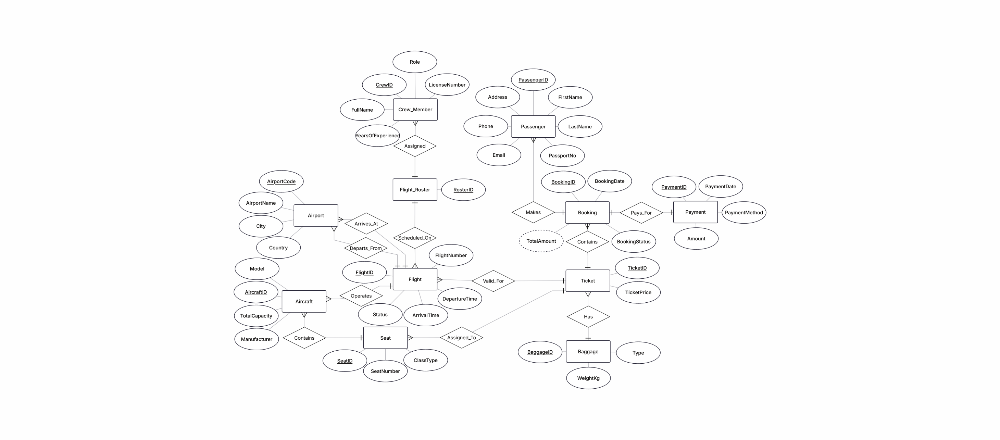
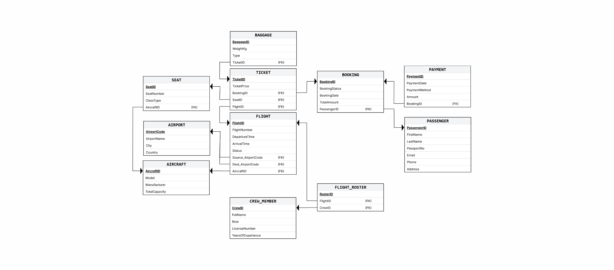
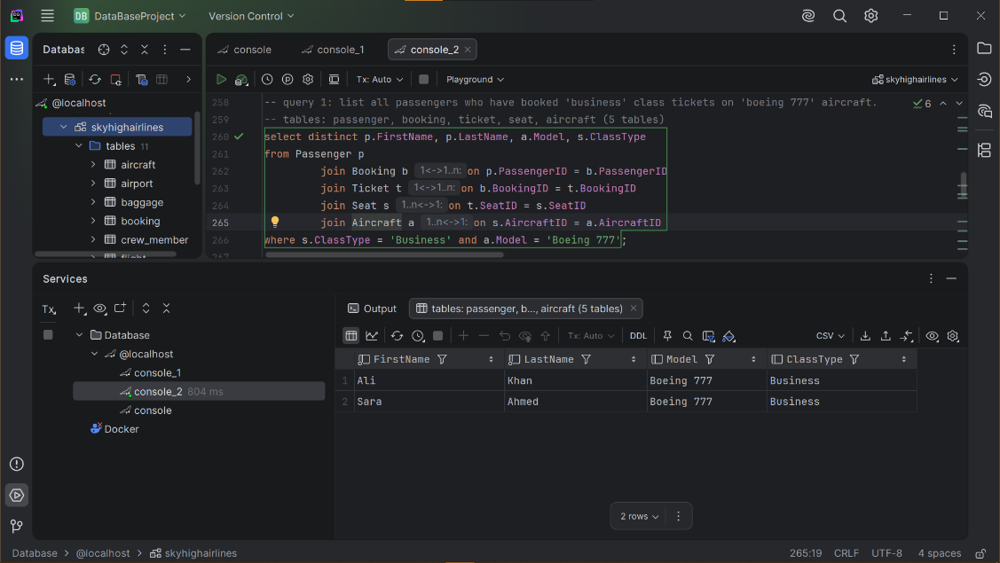

# ✈️ SkyHigh Airlines Management System

A relational database for **SkyHigh Airlines**, a fictional commercial airline. It covers flight scheduling, passenger bookings, ticketing, seat allocation, crew rostering, payments, and baggage handling.

Built as a **Database Systems** course project (Software Engineering, University of Central Punjab).

---

## 📌 Overview

Many airline workflows still run on disconnected systems, which leads to redundant and inconsistent data. This project centralises those operations in one normalised schema with enforced integrity constraints.

**What the database supports**

- **Flight management:** schedule direct flights between airports using available aircraft and track status (Scheduled, Delayed, Cancelled, Completed).
- **Booking lifecycle:** a booking can cover multiple passengers, a payment confirms it, and tickets are issued against specific seats.
- **Resource management:** assign crew (pilots, co-pilots, attendants) to flights through a roster table.
- **Baggage handling:** link each bag to a ticket, with weight and type.

**Assumptions and constraints**

- Direct point-to-point flights only (no layovers).
- One-way tickets only; a return trip is a separate booking.
- A booking is *Confirmed* only once a payment record exists.
- Seats are defined per aircraft and cannot be double-booked on the same flight.

---

## 🗂️ Entities

| # | Entity | Purpose |
|---|--------|---------|
| 1 | `Airport` | IATA code, name, city, country |
| 2 | `Aircraft` | Model, manufacturer, total capacity |
| 3 | `Passenger` | Personal details, unique passport number |
| 4 | `Crew_Member` | Role, licence number, experience |
| 5 | `Flight` | Route, aircraft, times, status |
| 6 | `Seat` | Seat number and class per aircraft |
| 7 | `Booking` | Reservation made by a passenger |
| 8 | `Ticket` | Links booking, flight and seat, with price |
| 9 | `Payment` | One payment per booking |
| 10 | `Baggage` | Weight and type per ticket |
| 11 | `Flight_Roster` | Bridge table for the Flight ↔ Crew many-to-many |

### Key relationships

- Airport → Flight: one-to-many (as source or destination)
- Aircraft → Flight, Aircraft → Seat: one-to-many
- Passenger → Booking → Ticket: one-to-many
- Booking → Payment: one-to-one
- Ticket → Baggage: one-to-many
- Flight ↔ Crew_Member: many-to-many via `Flight_Roster`

---

## 📐 Diagrams

**Entity Relationship Diagram**



**Relational Schema**



---

## 🛠️ Tech Stack

- **Database:** MySQL (uses `LIMIT` and `DATE()`)
- **Language:** SQL (DDL, DML, DQL)
- **Tools:** MySQL Workbench or any MySQL client

---

## 🚀 Getting Started

1. **Install MySQL** (8.0 or later recommended) and a client such as MySQL Workbench.
2. **Clone this repository**
   ```bash
   git clone https://github.com/L1S24BSSE0071/SkyHigh-Airlines-DBMS.git
   cd SkyHigh-Airlines-DBMS
   ```
3. **Run the script.** It creates the `SkyHighAirlines` database, all 11 tables, the sample data, and the 24 queries.
   ```bash
   mysql -u root -p < sql/skyhigh_ddl_dml.sql
   ```
   Or open `sql/skyhigh_ddl_dml.sql` in MySQL Workbench and run it.
4. **Explore**
   ```sql
   USE SkyHighAirlines;
   SHOW TABLES;
   SELECT * FROM Flight;
   ```

> The script contains `CREATE DATABASE SkyHighAirlines;`. Drop the database first if you want to re-run it from scratch.

---

## 🔍 Sample Queries

The script includes **24 queries** that use multi-table joins, subqueries, aggregation, `NOT EXISTS`, and comparisons against averages. Screenshots of each query's output are in [`screenshots/`](screenshots/).

| # | Query |
|---|-------|
| 1 | Passengers who booked Business class on Boeing 777 aircraft |
| 2 | Total baggage weight per passenger on flights departing from Lahore |
| 3 | Payment details for flights landing in Dubai |
| 4 | Crew members assigned to Airbus A320 flights |
| 5 | Passengers who paid more than 2000 by credit card |
| 6 | Each flight with its aircraft model and number of bags checked in |
| 7 | Seat number and class for passengers travelling to London (LHR) |
| 8 | Emails of passengers whose flights were cancelled |
| 9 | Total revenue from Economy seats |
| 10 | Pilots who flew flights departing from Karachi |
| 11 | Bookings with checked baggage heavier than 20 kg |
| 12 | Destination airports that received Business class passengers |
| 13 | Passengers who paid more than the average payment |
| 14 | Flights with no passengers (`NOT EXISTS`) |
| 15 | Aircraft model on the flight with the highest ticket price |
| 16 | Passengers who booked a London flight but haven't paid |
| 17 | Crew who have never been assigned to a Boeing 777 flight |
| 18 | Passenger with the heaviest bag on a flight departing Islamabad |
| 19 | Destination airports for flights piloted by Capt. Ahmed |
| 20 | Total seats on Airbus aircraft |
| 21 | Passengers with bookings on the same date as Ali Khan |
| 22 | Flights whose aircraft capacity is above the average |
| 23 | Business class passengers who paid less than the average Economy price |
| 24 | Airport with the most departures |

Example output (Query 1):



---

## 📁 Repository Structure

```
SkyHigh-Airlines-DBMS/
├── README.md
├── .gitignore
├── sql/
│   └── skyhigh_ddl_dml.sql
├── diagrams/
│   ├── erd.png
│   └── relational_schema.png
├── docs/
│   └── Project_Proposal.docx
└── screenshots/
    └── query_01.png … query_24.png
```

---

## 👥 Team

| Name | Reg. No. |
|------|----------|
| Taha Adris | L1S24BSSE0088 |
| Muhammad Shakeeb Amin | L1S24BSSE0080 |
| Zohaib Akmal | L1S24BSSE0071 |
| Huzaifa Abdul Rehman | L1S24BSSE0047 |
| Muhammad Danish | L1S24BSSE0059 |

**Course:** Database Systems, Section D1, Department of Software Engineering
**Instructor:** Nafey Ahmed
**Submitted:** 18 January 2026

---

## 📄 License

Released for educational purposes. Add a `LICENSE` file (e.g. MIT) if you want others to reuse it.
